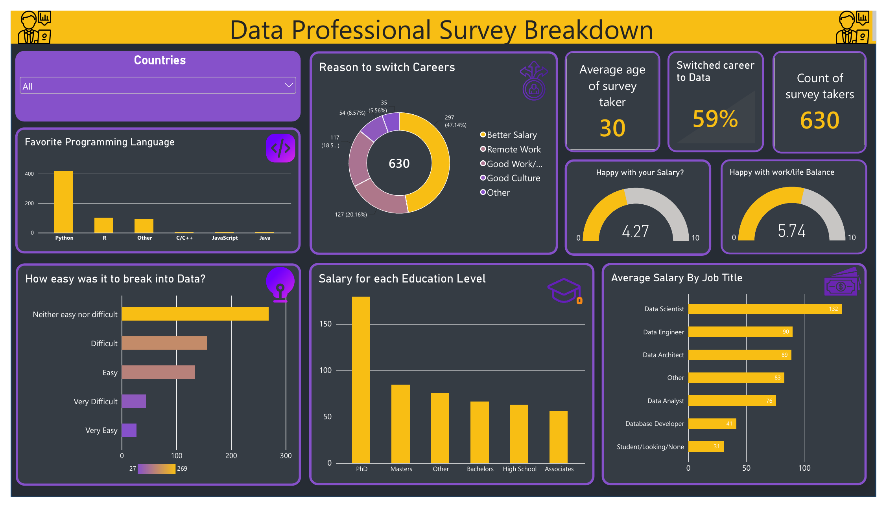

# Data Professional Survey Dashboard (Power BI)

An interactive Power BI dashboard built from a survey of 630 data professionals. It covers who they are, how they got into data, what they earn by role and education, and how satisfied they are.



## Origin

This started from a Power BI tutorial ([video](https://www.youtube.com/watch?v=pixlHHe_lNQ&list=PLUaB-1hjhk8HqnmK0gQhfmIdCbxwoAoys&index=9)), which uses the survey workbook from that course. The tutorial's dashboard had a country treemap, average salary by job title, a favourite-language chart, a difficulty donut, two satisfaction gauges and two headline numbers. I rebuilt and extended it:

- A new dark purple and yellow design with icons and a consistent card layout
- A **country slicer** in place of the treemap, so every visual can be filtered by country
- **Salary by education level**, a new view that is not in the tutorial dashboard
- A **career-switch KPI** (59% moved into data) and a chart of what matters most in a new job
- "How easy was it to break into data?" as a ranked bar chart in place of the tutorial's donut

## Questions the dashboard answers

- What do data professionals earn, and how does it vary by job title and education level?
- How many switched careers into data, and how hard was it to break in?
- What matters most when looking for a new job?
- Which programming language do they prefer?
- How happy are they with their salary and their work/life balance?

A country slicer filters every visual.

## Key findings

- **Python dominates.** 420 of 630 respondents (67%) named it as their favourite language, ahead of R (101, 16%).
- **Salary comes first.** "Better salary" was the top priority for a new job (297 respondents, 47%), ahead of remote work (127, 20%) and work/life balance (117, 19%).
- **Breaking in is a mixed picture.** 43% found it neither easy nor difficult, 32% found it difficult or very difficult, and 26% found it easy or very easy. 59% of respondents switched careers into data.
- **People are happier with their balance than their pay.** Average satisfaction is 5.7/10 for work/life balance and 4.3/10 for salary.
- **Pay varies a lot by role and education.** Data Scientists average about 94k a year against about 55k for Data Analysts, and Masters holders about 61k against about 49k for Bachelors holders. Average salary (bracket midpoints, $k per year):

| Job title | Avg salary ($k) | Respondents |
|---|---|---|
| Data Scientist | 94 | 25 |
| Data Engineer | 65 | 38 |
| Data Architect | 64 | 3 |
| Other | 60 | 88 |
| Data Analyst | 55 | 381 |
| Database Developer | 33 | 5 |
| Student / Looking / None | 27 | 90 |

| Education | Avg salary ($k) | Respondents |
|---|---|---|
| PhD | 125 | 5 |
| Masters | 61 | 192 |
| Other (incl. blank) | 56 | 52 |
| Bachelors | 49 | 329 |
| High School | 48 | 36 |
| Associates | 43 | 16 |

Treat the Data Architect, Database Developer and PhD rows with caution because each rests on 3 to 5 people.

## Data cleaning and transformation (Power Query)

The full script is in [`powerbi/data_professional_survey.m`](powerbi/data_professional_survey.m). The main steps:

1. Promote headers and set data types (dates, times, whole numbers, text).
2. Strip the free-text tails from "Other (Please Specify):..." answers for job title, industry, country and new-job priority by keeping the text before the `(`. For favourite programming language, keep the text before the `:`.
3. Convert salary brackets such as `41k-65k` into a low and a high value, then compute **Average Salary** as the midpoint, `(low + high) / 2`. The open-ended top bracket `225k+` is counted as 225.
4. Replace blank education values with "Other".
5. Drop columns with no data: Browser, OS, City, Country, Referrer.

## Limitations

- **Salary is a bracket estimate.** Respondents chose a range, so the averages use bracket midpoints and understate the top bracket.
- **Small groups.** Several job titles and the PhD group have very few respondents.
- **"Other" hides detail.** 36% of respondents have their country grouped under "Other". For programming language, 52 respondents wrote SQL under "Other", so SQL is counted in the "Other" bar rather than shown on its own.
- **Self-selected sample.** The respondents chose to take the survey, so the results describe them and not data professionals in general.

## Repository layout

```
data/      Raw survey workbook (Power BI - Final Project.xlsx)
powerbi/   Power BI template (.pbit) and the Power Query (M) script
docs/      Dashboard export (PDF and PNG)
```

## Open it

1. Install Power BI Desktop (Windows).
2. Open `powerbi/Data_Professionals_Survey.pbit`.
3. If the refresh fails because the file path is wrong, go to **Transform data > Data source settings** and point the source at `data/Power BI - Final Project.xlsx`.
